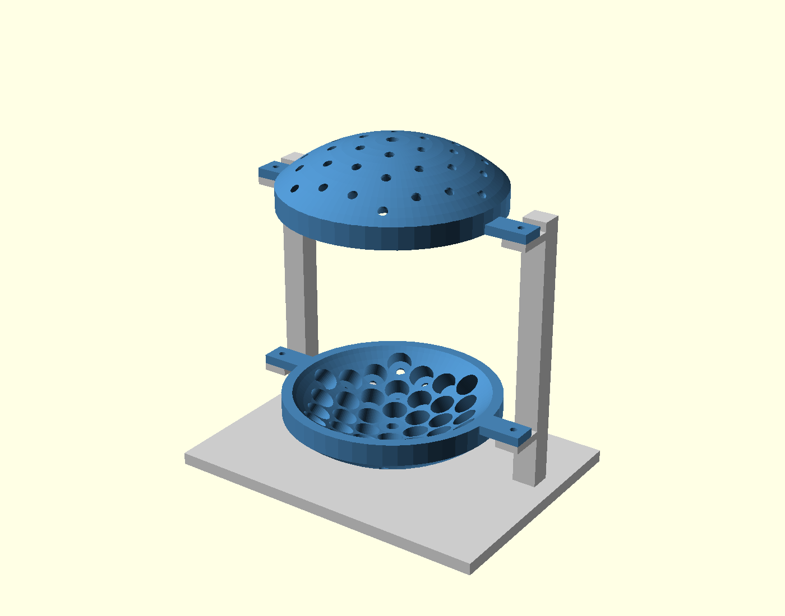
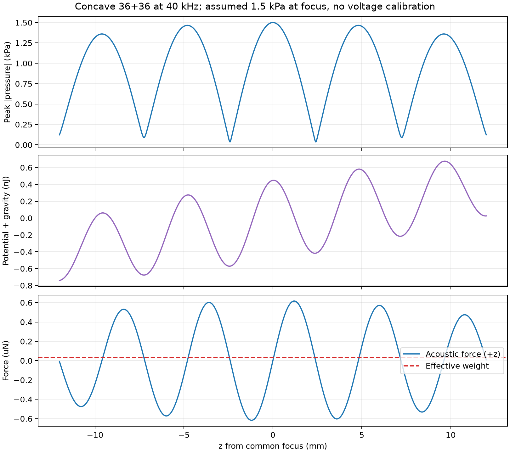
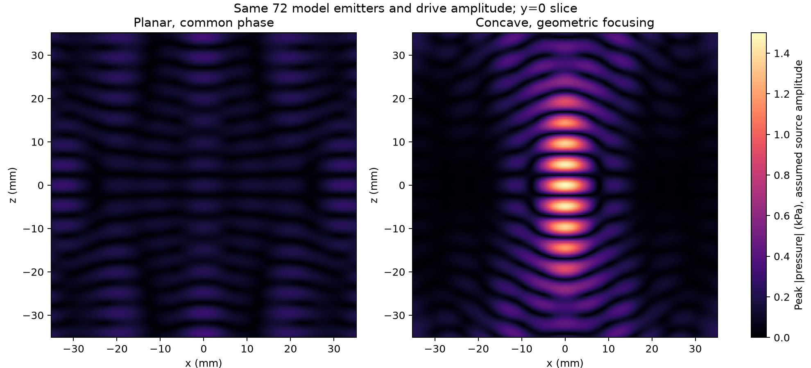
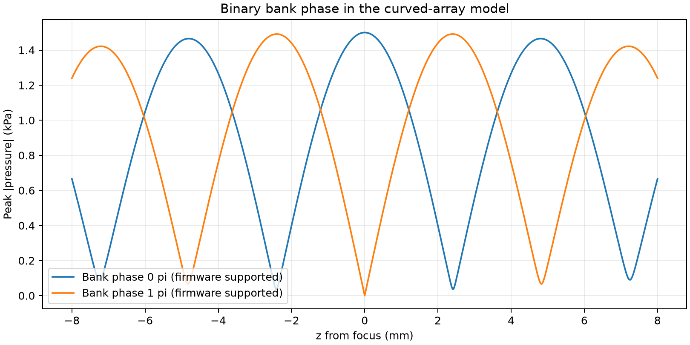
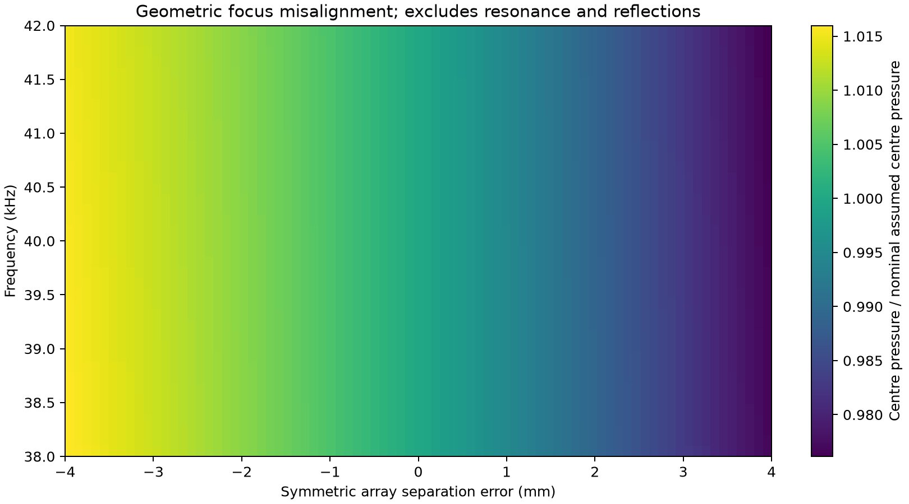
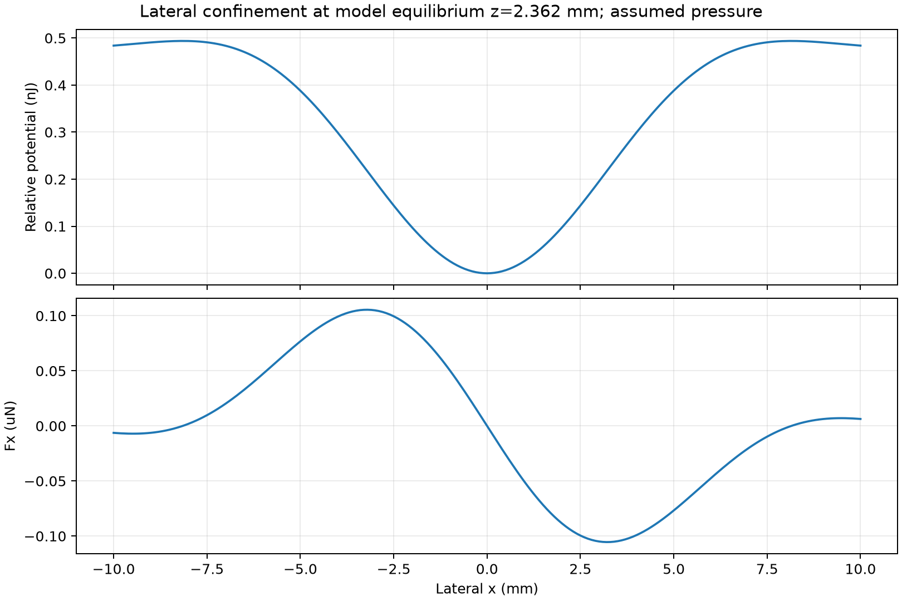
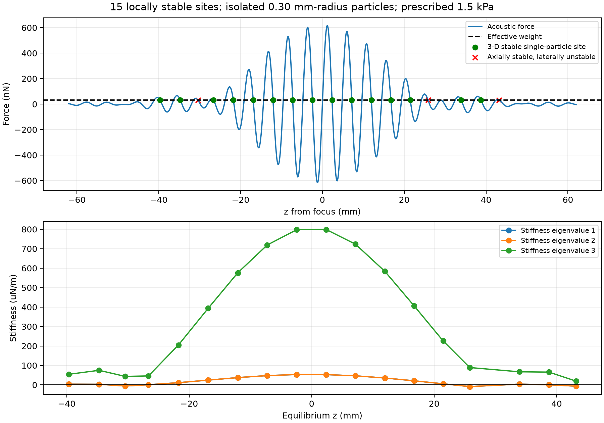
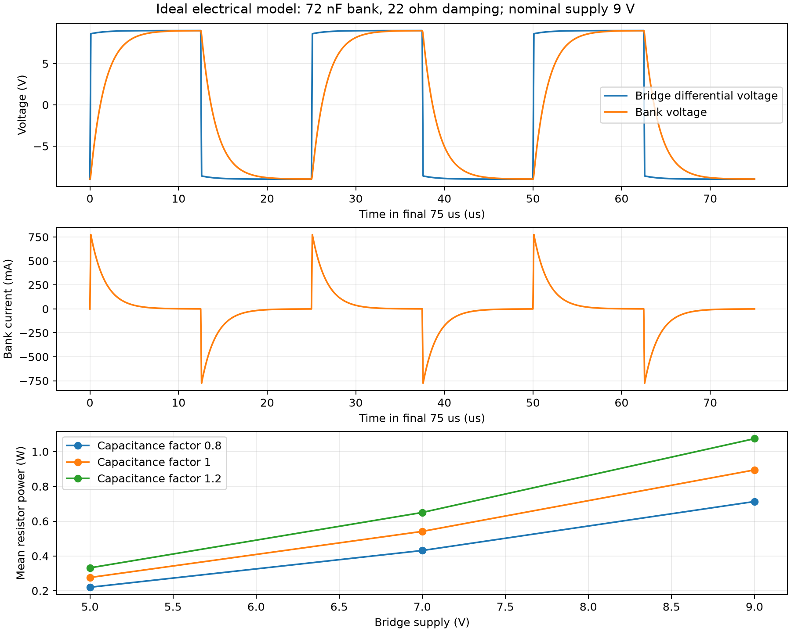

# Фізика та результати розрахунків

Для опису поля було використано лінійну акустику, а для сили, що діє на малу частинку, — потенціал Горькова. У цьому розділі розрахунок послідовно проходить від руху повітря до рівноваги, геометрії, електричного навантаження та отриманих графіків. Номери джерел [1]–[5] відповідають бібліографії в головному README.

У вибраній конструкції 72 передавальні капсулі з HC-SR04, два увігнуті масиви, Arduino Uno, логіка 5 В і міст із живленням 9 В. Чисельне поле задано піковим тиском 1,5 кПа у спільному фокусі незалежно від електричної моделі. Нижче наведено розрахунок та його результати.

## 1. Звук, частота та довжина хвилі

Коливання мембрани створюють малі зміни тиску й густини повітря. Частинки повітря коливаються біля положення спокою, а хвиля переносить енергію через середовище. Ультразвук має частоту понад 20 кГц. Вибраний сигнал 40 кГц здійснює один цикл за 25 мкс.

У розрахунку було використано густину сухого повітря 1,2041 кг/м³, швидкість звуку 343,2 м/с і прискорення вільного падіння 9,80665 м/с². Саме ці сталі задано в симуляції. Частота — кількість циклів за секунду, довжина хвилі — відстань поширення за один цикл, а хвильове число описує просторову фазу:

```math
T=\frac1f=25\ \mu\mathrm{s},\qquad
\lambda=\frac{c_0}{f}=8.580\ \mathrm{mm},\qquad
\omega=2\pi f,\qquad k=\frac{2\pi}{\lambda}=732.306\ \mathrm{m^{-1}}.
```

Температура впливає на довжину хвилі через швидкість звуку. Для ідеального газу γ — відношення теплоємностей, Rₛ — питома газова стала, Θ — абсолютна температура:

```math
c_0=\sqrt{\gamma R_s\Theta},\qquad \frac{\delta\lambda}{\lambda}\simeq\frac{\delta\Theta}{2\Theta}\quad(f=\mathrm{const}).
```

## 2. Від законів збереження до хвильового рівняння

Тиск і густина складаються зі сталого значення та малого акустичного збурення. Для однорідного середовища без середньої течії закони збереження маси й імпульсу та лінійний зв’язок тиску з густиною дають:

```math
p=p_0+p_1,\qquad \rho=\rho_0+\rho_1,
\qquad p_1=c_0^2\rho_1,
\\
\frac{\partial\rho_1}{\partial t}+\rho_0\nabla\cdot\mathbf v_1=0,
\qquad \rho_0\frac{\partial\mathbf v_1}{\partial t}=-\nabla p_1.
```

Після диференціювання рівняння неперервності за часом і підстановки рівняння руху швидкість виключається. Гармонічний розв’язок використовує комплексну амплітуду тиску P та наведену часову залежність. Фізичний тиск — її дійсна частина; комплексна швидкість визначається з градієнта тиску [2, 3]:

```math
\nabla^2p_1-\frac1{c_0^2}\frac{\partial^2p_1}{\partial t^2}=0,
\qquad p_1(\mathbf r,t)=\mathrm{Re}\{P(\mathbf r)e^{i\omega t}\},
\\
\nabla^2P+k^2P=0,\qquad
\mathbf V=-\frac{\nabla P}{i\omega\rho_0}.
```

## 3. Стояча хвиля та фаза

Дві однакові хвилі, що поширюються назустріч, інтерферують та утворюють стоячу хвилю. За відповідного вибору початку координат тиск і осьова швидкість мають вигляд:

```math
p_1(z,t)=p_a\cos(kz)\cos(\omega t),\qquad
v_{1z}(z,t)=\frac{p_a}{\rho_0c_0}\sin(kz)\sin(\omega t),
\\
z_n=\frac{(2n+1)\lambda}{4},\qquad
\Delta z=\frac\lambda2=4.290\ \mathrm{mm}.
```

У вузлах амплітуда тиску нульова, а амплітуда швидкості максимальна. У пучностях — навпаки. Реальне сфокусоване поле тривимірне, тому крок вузлів плоскої хвилі є орієнтиром, а не точним переліком положень пасток.

Прошивка забезпечує відносні фази 0° та 180°. У наближенні плоскої хвилі зміна фази зміщує картину на:

```math
|\Delta z|=\frac{|\Delta\phi|}{2k}=\frac{\lambda|\Delta\phi|}{4\pi},
\qquad |\Delta z|_{\Delta\phi=\pi}=2.145\ \mathrm{mm}.
```

Для плоскої резонансної порожнини відстань може задовольняти умову цілого числа півхвиль. В увігнутій конструкції робочі поверхні розташовані відносно спільного геометричного фокуса; відстань 180 мм між полюсами не округлюється до цієї умови:

```math
L_{\mathrm{plane\ cavity}}=n\frac\lambda2,\qquad n\in\mathbb N.
```

## 4. Чому хвиля з нульовим середнім тиском створює середню силу

За період тиск і швидкість усереднюються до нуля, але їхні квадрати — ні. Радіаційна сила виникає через перенесення імпульсу другого порядку під час розсіювання [2, 3]. Для пікових комплексних амплітуд середні квадрати містять множник одна друга:

```math
\langle p_1^2\rangle=\frac{|P|^2}{2},\qquad
\langle|\mathbf v_1|^2\rangle=\frac{|\mathbf V|^2}{2},
\\
e_{\mathrm{ac}}=\frac{p_1^2}{2\rho_0c_0^2}+\frac{\rho_0|\mathbf v_1|^2}{2}.
```

Для біжної плоскої хвилі інтенсивність визначається наведеною формулою. Повне поглинання та дзеркальне відбиття плоскою поверхнею дають радіаційний тиск I/c₀ і 2I/c₀ відповідно. Мала сфера не є плоским відбивачем, тому для її сили потрібен вираз, отриманий із розсіювання. Ідеальна стояча хвиля може мати нульову результуючу інтенсивність перенесення й водночас створювати градієнтну силу.

```math
I=\langle p_1v_1\rangle=\frac{p_{\mathrm{rms}}^2}{\rho_0c_0}\quad\text{(travelling plane wave)}.
```

## 5. Властивості частинки та потенціал Горькова

Частинка в моделі — сфера радіусом 0,30 мм і густиною 30 кг/м³, яка представляє легку пінопластову кульку. Було використано стисливість 2,5 × 10⁻¹⁰ Па⁻¹ як наближення жорсткої частинки. Результат залежить від цього наближення жорсткої частинки для пористого матеріалу. Стисливість середовища, об’єм частинки та два коефіцієнти контрасту:

```math
\kappa_0=\frac1{\rho_0c_0^2},\qquad V_p=\frac{4\pi a^3}{3},
\qquad f_1=1-\frac{\kappa_p}{\kappa_0},\qquad
f_2=\frac{2(\rho_p-\rho_0)}{2\rho_p+\rho_0}.
```

Монопольний коефіцієнт описує контраст стисливості, дипольний — контраст густини. У наближенні малої сфери й нев’язкого середовища усереднені потенціал і сила мають вигляд [2, 3]:

```math
U_G=V_p\left[\frac{f_1\kappa_0}{2}\langle p_1^2\rangle
-\frac{3f_2\rho_0}{4}\langle|\mathbf v_1|^2\rangle\right]
=V_p\left[\frac{f_1|P|^2}{4\rho_0c_0^2}-\frac{3f_2\rho_0|\mathbf V|^2}{8}\right],
\\
\mathbf F_{\mathrm{rad}}=-\nabla U_G.
```

Для одновимірної стоячої хвилі після групування просторових доданків отримуємо наведений вираз. Визначення Φ вказано явно; у частині літератури коефіцієнт контрасту втричі менший. Додатне Φ відповідає стійким положенням біля вузлів тиску за відсутності ваги.

```math
E_{\mathrm{ac}}=\frac{p_a^2}{4\rho_0c_0^2},\qquad
\Phi=f_1+\frac32f_2,\qquad
F_{\mathrm{rad},z}=V_pkE_{\mathrm{ac}}\Phi\sin(2kz).
```

## 6. Вага та стійкість у трьох вимірах

Вертикальна вісь спрямована вгору; виштовхувальна сила зменшує ефективну вагу. Рівновага потребує нульової результуючої сили, а локальна стійкість — сили, що повертає частинку після малого зміщення.

```math
W_{\mathrm{eff}}=(\rho_p-\rho_0)V_pg,\qquad
\mathbf F_{\mathrm{net}}=\mathbf F_{\mathrm{rad}}-W_{\mathrm{eff}}\hat{\mathbf z},
\\
U_{\mathrm{total}}=U_G+W_{\mathrm{eff}}z,\qquad
\mathbf F_{\mathrm{net}}(\mathbf r_0)=\mathbf0,\qquad
K_{ij}=\frac{\partial^2U_{\mathrm{total}}}{\partial x_i\partial x_j}
=-\frac{\partial F_{\mathrm{net},i}}{\partial x_j}.
```

Усі три власні значення матриці жорсткості мають бути додатними. Сам перетин осьової сили з вагою не означає утримання вбік. У чисельному розрахунку матриця Якобі сили симетризується перед обчисленням власних значень.

Умова підтримання в ідеальній плоскій хвилі та відповідний поріг тиску:

```math
kE_{\mathrm{ac}}|\Phi|>(\rho_p-\rho_0)g,\qquad
p_{a,\min}=\sqrt{\frac{4\rho_0c_0^2(\rho_p-\rho_0)g}{k|\Phi|}}
=301.20\ \mathrm{Pa}.
```

Це необхідний поріг амплітуди сили для одновимірного прикладу, а не поріг поперечної стійкості реального масиву. Об’єм скорочується, оскільки вага й сила в наближенні Релея пропорційні об’єму частинки. Це не означає застосовності моделі до частинок довільного розміру.

## 7. Геометрія увігнутих масивів і поле джерел

Кожну групу з 36 передавачів було розташовано у трьох шестикутних кільцях із кроком у проєкції 18 мм і радіусом фокуса 90 мм. Розміри корпусу 16 × 13 мм отримано з приблизних вимірів. Для цих деталей у моделі задано отвори 16,4 мм, оболонку 15 мм і збільшену основу 220 × 158 мм. Точка верхньої або нижньої сферичної поверхні та її нормаль усередину задовольняють:

```math
\mathbf r_n=(x_n,y_n,\ \pm\sqrt{R^2-x_n^2-y_n^2}),\qquad
|\mathbf r_n|=R=90\ \mathrm{mm},\qquad \mathbf n_n=-\frac{\mathbf r_n}{R}.
```

Однакові відстані поширення та спрямовані всередину осі забезпечують геометричне фокусування [1]. Тиск масиву є сумою полів поршнів в екрані, що випромінюють уперед, у наближенні далекого поля. J₁ — функція Бесселя першого порядку, b — ефективний радіус поршня, dₙ — відстань від джерела до точки спостереження, θₙ — кут відносно нормалі всередину:

```math
P(\mathbf r)=\sum_{n=1}^{72} A_{\mathrm{ref}}\frac{r_{\mathrm{ref}}}{d_n}
D(\theta_n)e^{-ikd_n+i\phi_n},\qquad
D(\theta)=\frac{2J_1(kb\sin\theta)}{kb\sin\theta},\quad D(0)=1,
\\
b=6\ \mathrm{mm},\qquad r_{\mathrm{ref}}=0.1\ \mathrm m,\qquad
A_{\mathrm{ref}}=\frac{1500R}{72r_{\mathrm{ref}}}=18.75\ \mathrm{Pa}.
```

Джерела додають поле лише в передній півсфері. Прийнятий активний радіус 6 мм відрізняється від радіуса корпусу 8 мм. Опорна амплітуда задається один раз для номінальної геометрії та зберігається в порівняннях. Швидкість у всьому розрахунку отримується з градієнта тиску; співвідношення імпедансу плоскої хвилі не нав’язується сфокусованому полю.

Задане поле не враховує відбиття від конструкції, взаємодію джерел, реальні моди мембран, термов’язкі втрати, акустичні течії, розбіжності амплітуд і фаз та нелінійне поширення. Потенціал малої частинки також не враховує розсіювання між частинками. Ці припущення визначають межі наведених кількостей і мас.



Дві чаші мають спільну раму; монтажні вушка спираються на полиці. Візуалізація показує збільшену геометрію.

## 8. Тиск, потенціал і сила вздовж осі



Верхня панель показує модуль пікової амплітуди тиску. Середня додає гравітацію до акустичного потенціалу; локальний мінімум є кандидатом на вертикальну рівновагу. Нижня порівнює спрямовану вгору акустичну силу з ефективною вагою. Перетин стійкий по вертикалі, якщо крива акустичної сили спадає. Графіки пояснюють, чому самого вузла тиску недостатньо для перевірки рівноваги.

Найближча стійка рівновага на додатній півосі для 40 кГц розташована за 2,3615 мм від спільного фокуса. Сила в ній урівноважує ефективну вагу 31,9377 нН.

| Частота, кГц | Довжина хвилі, мм | Рівновага z, мм | K₁, мкН/м | K₂, мкН/м | K₃, мкН/м |
|---:|---:|---:|---:|---:|---:|
| 38.0000 | 9.0316 | 2.4836 | 47.7405 | 47.7405 | 720.5525 |
| 40.0000 | 8.5800 | 2.3615 | 52.9028 | 52.9028 | 798.4328 |
| 42.0000 | 8.1714 | 2.2508 | 58.3301 | 58.3301 | 880.2910 |

У цих вибраних рівновагах усі три власні значення додатні. Порівняння частот зберігає сталу амплітуду джерел і не враховує частотної резонансної характеристики передавача.

## 9. Що змінює фокусування



Обидві карти використовують однакові амплітуди 72 джерел і спільну шкалу кольорів у вертикальній площині через вісь. Увігнутий масив зводить синфазні хвилі у спільний фокус. Плоский варіант зберігає спільну електричну фазу без індивідуальної компенсації відстаней поширення. Отже, зображення порівнює дві геометрії за однакового двоканального керування; воно не означає, що плоскі масиви з електронним фокусуванням не можуть забезпечувати левітацію.

## 10. Фаза та геометрична чутливість



Зміна відносної фази масивів із 0 до 180° замінює конструктивну інтерференцію в центрі взаємним гасінням і зміщує ближню картину тиску. Крива показує лише тиск: сама собою вона не визначає стійких положень навантаженої частинки.



Карта змінює частоту та симетрично розсуває або зближує масиви зі збереженням орієнтацій і амплітуд джерел. Вона показує чутливість до розходження геометричних фокусів. Це не резонансна характеристика передавача: частотні залежності електричного імпедансу, виходу джерел і відбиття в порожнині тут відсутні.

## 11. Утримання в поперечному напрямку



Переріз проходить через вибрану вертикальну рівновагу. Потенціал зростає по обидва боки осі, а поперечна сила за малих зміщень спрямована назад до центра. Це локальний механізм, що не дає кульці просто випасти вбік із вертикально стійкого шару. Додатна жорсткість описує малі зміщення, але не визначає всієї області захоплення чи динаміки введення частинки.

## 12. Скільки об’єктів може бути у вертикальному стовпчику?

Опорний крок вузлів плоскої хвилі — 4,290 мм. Було досліджено центральний інтервал від −62 до +62 мм із відступом 10 мм від площин найближчих протилежних центрів робочих поверхонь. Для рівномірної сітки вузлів найбільша кількість вузлів, які можуть поміститися в інтервалі довжини L:

```math
N_{\mathrm{plane,max}}=\left\lfloor\frac{L}{\lambda/2}\right\rfloor+1=\left\lfloor\frac{124}{4.290}\right\rfloor+1=29.
```

Це число описує лише рівномірну сітку плоскої хвилі; воно не є гарантованою кількістю чи строгою верхньою межею для неоднорідного сфокусованого поля. У повному розрахунку знаходяться перетини сили з ефективною вагою та обчислюються всі три власні значення жорсткості в кожному перетині.



Верхня панель позначає рівноваги на кривій сили. Зелені точки мають три додатні власні значення жорсткості; червоні хрестики втрачають поперечне утримання. Нижня панель явно показує ці власні значення. Для окремої модельної частинки за опорного тиску 1,5 кПа отримано **18 осьово стійких рівноваг, із них 15 локально стійких тривимірних положень**. Кількість не змінюється при зменшенні кроку пошуку з 0,10 до 0,05 мм і кроку скінченних різниць із 20 до 10 мкм.

Таблиця містить усі осьово стійкі положення в дослідженому інтервалі:

| z, мм | Мінімальна жорсткість, мкН/м | Стійкість у 3D |
|---:|---:|---|
| -39.6780 | 3.8110 | Так |
| -34.7094 | 3.1700 | Так |
| -30.4404 | -5.7870 | Ні |
| -26.6466 | 0.8747 | Так |
| -21.7573 | 11.4235 | Так |
| -16.9031 | 24.5050 | Так |
| -12.0691 | 37.5331 | Так |
| -7.2502 | 47.8106 | Так |
| -2.4414 | 53.2892 | Так |
| 2.3615 | 52.9077 | Так |
| 7.1617 | 46.6205 | Так |
| 11.9592 | 35.3752 | Так |
| 16.7438 | 21.0100 | Так |
| 21.4647 | 5.6839 | Так |
| 25.8145 | -8.7864 | Ні |
| 33.9018 | 4.0173 | Так |
| 38.7466 | 0.6267 | Так |
| 43.1816 | -6.5920 | Ні |

Одна частинка в кожному стійкому положенні дає **сценарій незалежного заповнення 15 частинками** в межах одночастинкової моделі. Частинки розсіюють звук, впливають одна на одну, можуть зближуватися або втрачати стійкість під час введення. Модель не розв’язує ці взаємодії, пастки поза віссю чи рівноваги за межами заданого інтервалу. Задача одночасного заповнення додатково залежить від цих взаємодій.

## 13. Маса, вага та обмеження розміру

Маса й сила — різні величини: маса наведена в мікрограмах, вага — у наноньютонах. Для вибраної сфери:

```math
m=\rho_p\frac{4\pi a^3}{3}=3.39292\times10^{-9}\ \mathrm{kg}
=3.39292\ \mu\mathrm g=0.00339292\ \mathrm{mg},
\\
mg=33.2732\ \mathrm{nN},\qquad W_{\mathrm{eff}}=31.9377\ \mathrm{nN},
\qquad M_{15}=15m=50.8938\ \mu\mathrm g=0.0508938\ \mathrm{mg}.
```

Сумарна маса передбачає незалежне заповнення всіх 15 положень. Це не маса одного вантажу, який утримує одна пастка.

Наближення малої сфери потребує параметра розміру, значно меншого за одиницю. Значення 0,3 було прийнято як явно задану межу моделювання, а не фізичний максимум розміру левітованого об’єкта:

```math
ka=\frac{2\pi a}{\lambda}=0.21969,\qquad
ka\le0.3\ \Longrightarrow\ a\le0.409665\ \mathrm{mm},
\\
m_{ka\le0.3,\,\rho_p=30}=8.63964\ \mu\mathrm g.
```

За сталих властивостей матеріалу і вага, і сила пропорційні об’єму, тому в межах наближення малої частинки модель дає ті самі положення рівноваги. Значення 8,640 мкг — маса на вибраній межі застосовності моделі малої частинки.

Найбільша знайдена на сітці спрямована вгору акустична сила для вихідної частинки 0,30 мм становить 616,619 нН. Еквівалентна цій силі підтримувана маса з урахуванням виштовхування — 63,014 мкг:

```math
m_{\mathrm{force\ equivalent}}=\frac{\max_zF_{\mathrm{rad},z}}g+\rho_0V_p=63.014\ \mu\mathrm g.
```

Це оцінка запасу сили для заданої частинки, а не допустима маса довільної частинки на заміну: зміна густини змінює контраст, а зміна розміру — і розсіювання, і вагу. Для справжньої максимальної вантажності потрібні ці властивості та реальна акустична амплітуда. Сила пропорційна квадрату тиску, тому зменшення тиску вдвічі зменшує акустичну силу вчетверо; кількість підтримуваних стійких положень також може змінитися.

```math
P\mapsto\alpha P\quad\Longrightarrow\quad U_G\mapsto\alpha^2U_G,\qquad \mathbf F_{\mathrm{rad}}\mapsto\alpha^2\mathbf F_{\mathrm{rad}}.
```

## 14. Електричне збудження та його зв’язок з акустикою

Arduino Uno формує 40 кГц від тактової частоти таймера 16 МГц. 74HC14 забезпечує комплементарні входи моста, а TB6612FNG подає диференційну напругу на кожен масив. Логіка живиться від 5 В; вибране живлення моста — 9 В. Кожен масив має послідовний резистор 22 Ом, 3 Вт. Для ідеального моста:

```math
f=\frac{16\,000\,000}{399+1}=40\,000\ \mathrm{Hz},\qquad
V_{\mathrm{bridge,pp}}=2V_M=18\ \mathrm V.
```

Модуль HC-SR04 видає короткі пакети для вимірювання відстані та має окремі передавальну й приймальну капсулі [4]. Вибрані деталі — випаяні передавачі. Номінальні 5 В модуля не визначають межі їхнього безперервного збудження змінною напругою. Для розрахунку електричної чутливості було прийнято припущення про ємність 2 нФ на капсуль. Номінальний ємнісний масив дає:

```math
C_{\mathrm{bank}}=36C_T=72\ \mathrm{nF},\qquad
|X_C|=\frac1{2\pi fC_{\mathrm{bank}}}=55.26\ \Omega,
\\
i_C=C\frac{dv_C}{dt},\qquad P_R=R\langle i^2\rangle=RI_{\mathrm{rms}}^2.
```

Прямокутний сигнал містить гармоніки, тому струм на фронтах не можна оцінити лише за реактивним опором основної частоти. SPICE інтегрує перехідні процеси заряджання через резистор та сумарний опір моста 0,5 Ом [5]. Суто ємнісне наближення не враховує електромеханічного резонансу; біля 40 кГц реальний комплексний імпеданс може істотно відрізнятися.



Перша панель показує напругу моста й масиву за три періоди усталеного режиму; друга — імпульси струму на фронтах. Третя дає потужність резистора для дев’яти сценаріїв чутливості. За вибраних 9 В і номінальних 72 нФ напруга масиву становить 17,983 В від піка до піка, середньоквадратичний струм — 201,6 мА, піковий — 775,4 мА, потужність резистора — 0,895 Вт на масив. Найбільша потужність резистора в переборі — 1,074 Вт. Ці значення описують ідеалізовану схему; втрати перемикання напівпровідників, паразитна індуктивність, нагрівання та ефективність акустичного перетворення відсутні.
